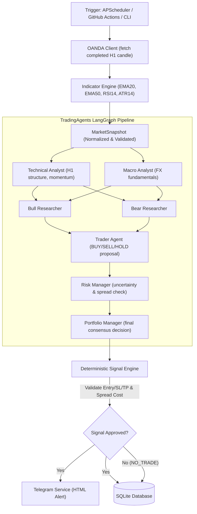

# 🤖 Forex AI Multi-Agent Telegram Signal Bot

[](https://www.python.org/downloads/)
[](https://github.com/langchain-ai/langgraph)
[](https://github.com/TauricResearch/TradingAgents)
[](https://aistudio.google.com/)
[](https://developer.oanda.com/)
[](https://core.telegram.org/bots/api)
[]()
[](https://github.com/astral-sh/ruff)

An automated quantitative research MVP that analyzes Forex major pairs on the **1-Hour (H1)** timeframe using the real open-source **TradingAgents** framework, **Google Gemini LLM**, **OANDA Forex Data API**, and delivers risk-managed trading signals to **Telegram**.

---

## 📑 Table of Contents

- [Key Features](#-key-features)
- [System Architecture](#-system-architecture)
- [Multi-Agent Reasoning Pipeline](#-multi-agent-reasoning-pipeline)
- [Windows Installation & Setup](#-windows-installation--setup)
- [Configuration (.env)](#-configuration-env)
- [CLI Commands & Usage](#-cli-commands--usage)
- [Automated Scheduling](#-automated-scheduling)
  - [Local APScheduler Daemon](#1-local-apscheduler-daemon-windows)
  - [GitHub Actions Scheduled Workflow](#2-github-actions-cloud-automation)
- [Telegram Signal Output](#-telegram-signal-output)
- [Database Schema & Auditing](#-database-schema--auditing)
- [Backtesting & Quantitative Evaluation](#-backtesting--quantitative-evaluation)
- [Offline Mock Testing](#-offline-mock-testing)
- [Documentation Index](#-documentation-index)
- [Safety & Disclaimer](#-safety--disclaimer)

---

## 🚀 Key Features

- **Genuine TradingAgents Integration**: Adapts the upstream LangGraph multi-agent architecture for Forex H1 candlestick series rather than a simplistic single-prompt chatbot.
- **Supported Currency Pairs**: `EUR_USD`, `GBP_USD`, `USD_JPY` on completed **H1** bars.
- **Zero Real-Money Risk**: Purely an alert/signal generation and research system. Contains no broker order execution methods.
- **Deterministic Signal Engine**:
  - Entry price strictly pinned to the verified close of the completed H1 candle (no LLM price fabrication).
  - Stop Loss and Take Profit mathematically computed via **ATR14** (`1.5 * ATR` SL, `3.0 * ATR` TP) delivering a guaranteed **2.0:1 Risk/Reward ratio** (enforces minimum R:R >= 1.5).
  - Pip scaling adapted to pair conventions (4 decimals for EUR/GBP, 2 decimals for JPY).
  - High-spread rejection (aborts trade if spread cost exceeds 20% of SL).
- **Dual Execution Modes**:
  1. **Local Mode**: Typer-powered CLI & APScheduler background daemon on Windows.
  2. **Cloud Mode**: Serverless scheduled execution via GitHub Actions (`.github/workflows/forex-signals.yml`).
- **Comprehensive Offline Test Suite**: 47 automated tests covering all components with mocked APIs (requires zero paid credentials to run tests).

---

## 🏛 System Architecture



Detailed architectural diagrams and component specifications are documented in [`docs/architecture.md`](file:///docs/architecture.md).

---

## 🧠 Multi-Agent Reasoning Pipeline

| Role | Default Model | Primary Objective |
| :--- | :--- | :--- |
| **Technical Analyst** | `gemini-2.5-flash` | Evaluates H1 market structure, EMA20/EMA50 trends, RSI14, and ATR14 volatility. |
| **Macro Analyst** | `gemini-2.5-flash` | Reviews currency pair macroeconomic policy stances. Never invents economic events. |
| **Bull Researcher** | `gemini-2.5-flash` | Constructs the strongest bullish case from verified analyst observations. |
| **Bear Researcher** | `gemini-2.5-flash` | Constructs the strongest bearish case and downside risks from verified data. |
| **Trader Agent** | `gemini-2.5-flash` | Debates Bull vs Bear and formulates an initial trade proposal (`BUY`, `SELL`, or `HOLD`). |
| **Risk Debater** | `gemini-2.5-pro` | Stress-tests proposal against spread, volatility, and market uncertainty. |
| **Portfolio Manager** | `gemini-2.5-pro` | Synthesizes all perspectives and renders the final verdict (`Buy`, `Sell`, or `Hold`). |

---

## 💻 Windows Installation & Setup

### Prerequisites
- Windows 10/11
- Python 3.11, 3.12, 3.13, or 3.14 (64-bit)
- Git for Windows

### Step 1: Clone Repository
```powershell
git clone https://github.com/ndmanh0612/MultiAgent_FX.git
cd MultiAgent_FX
```

### Step 2: Create and Activate Virtual Environment
```powershell
python -m venv .venv
.\.venv\Scripts\Activate.ps1
```

### Step 3: Install Dependencies
```powershell
pip install --upgrade pip
pip install -r requirements.txt
```

---

## ⚙️ Configuration (.env)

Copy `.env.example` to `.env`:
```powershell
Copy-Item .env.example .env
```

Configure your credentials in `.env`:
```ini
# ==========================================
# OANDA Practice API Credentials
# ==========================================
OANDA_API_KEY=your_oanda_practice_token
OANDA_ACCOUNT_ID=your_oanda_practice_account_id
OANDA_ENVIRONMENT=practice
OANDA_MOCK_MODE=false

# ==========================================
# Google Gemini API
# ==========================================
GEMINI_API_KEY=your_google_gemini_api_key
FOREX_QUICK_LLM=gemini-2.5-flash
FOREX_DEEP_LLM=gemini-2.5-pro

# ==========================================
# Telegram Bot Service
# ==========================================
TELEGRAM_BOT_TOKEN=your_bot_token_from_botfather
TELEGRAM_CHAT_ID=your_telegram_chat_id
TELEGRAM_DRY_RUN=false

# ==========================================
# Local Persistence
# ==========================================
FOREX_DB_PATH=data/forex_signals.db
```

---

## 🛠 CLI Commands & Usage

All commands are accessible via `python -m app.cli` or the registered script `forex-bot`:

### 1. Test Telegram Bot Connection
```powershell
# Live test message
python -m app.cli test-telegram

# Dry-run test (prints to console without sending network request)
python -m app.cli test-telegram --dry-run
```

### 2. Analyze a Single Currency Pair
```powershell
# Analyze EUR/USD on latest completed H1 bar
python -m app.cli analyze --symbol EUR_USD

# Analyze USD/JPY with offline mocks and dry-run telegram
python -m app.cli analyze --symbol USD_JPY --mock --dry-run
```

### 3. Sweep All Supported Pairs (EUR_USD, GBP_USD, USD_JPY)
```powershell
python -m app.cli run-once
```

---

## ⏱ Automated Scheduling

### 1. Local APScheduler Daemon (Windows)
Runs continuously in the background and automatically triggers 2 minutes after each H1 candle close (at `:02` past every hour):
```powershell
python -m app.cli scheduler --minute 2
```

### 2. GitHub Actions Cloud Automation
The repository includes `.github/workflows/forex-signals.yml` which executes automatically on GitHub's cloud runners:
- **Cron Schedule**: `2 * * * *` (hourly, 2 minutes past the hour UTC).
- **Manual Trigger**: Supports `workflow_dispatch` button from the GitHub Actions tab.
- **Required GitHub Secrets**:
  - `OANDA_API_KEY`
  - `OANDA_ACCOUNT_ID`
  - `GEMINI_API_KEY`
  - `TELEGRAM_BOT_TOKEN`
  - `TELEGRAM_CHAT_ID`

---

## 📱 Telegram Signal Output

When an approved trading setup is identified, an HTML-formatted notification is broadcasted:

```text
🚀 FOREX AI SIGNAL: BUY EUR/USD

⏱ Timeframe: H1
🎯 Action: BUY
📍 Entry: 1.08500
🛑 Stop Loss: 1.08200 (30.0 pips)
🎯 Take Profit: 1.09100 (60.0 pips)
⚖️ Risk / Reward: 1 : 2.0
📅 Candle Close: 2026-11-02 14:00:00 UTC

🤖 Multi-Agent Consensus:
Technical Analyst confirms price holding above EMA20 with RSI at 53.4. Bull Researcher highlights key order block rejection at 1.0820. Risk Manager verifies 1.2 pip spread is well within safe thresholds.

⚠️ Experimental algorithmic research signal. Not financial advice. Past performance does not guarantee future results.
```

More examples including JPY pairs and diagnostic pings are detailed in [`docs/telegram-example.md`](file:///docs/telegram-example.md).

---

## 🗄 Database Schema & Auditing

The local SQLite database (`data/forex_signals.db`) stores a full audit trail across 6 relational tables:
1. `market_snapshots`: Verified H1 OHLC bars, spreads, ATR14, RSI14, EMA20/50.
2. `analysis_runs`: Run execution metadata, duration, model identifiers.
3. `agent_decisions`: Full debate reasoning, analyst outputs, confidence scores.
4. `signals`: Calculated Entry, SL, TP, R:R, status (`PENDING`, `REJECTED`, `EXPIRED`).
5. `telegram_deliveries`: Delivery confirmations, message IDs, error logs.
6. `evaluation_results`: Post-trade settlement outcomes, net pips, holding bars.

---

## 📊 Backtesting & Quantitative Evaluation

The backtesting module ([`app/evaluation/backtester.py`](file:///app/evaluation/backtester.py)) features:
- **Zero Look-Ahead Bias**: Uses only data available at candle close.
- **Conservative Intrabar Resolution**: If an ambiguous candle hits both SL and TP in the same bar, the backtester conservatively scores it as a **Stop Loss hit** to avoid false optimism.
- **Baseline Comparison**: Directly benchmarks Multi-Agent LLM signals against a standard EMA20/50 trend crossover strategy.
- **Metrics Computed**: Win Rate %, Expectancy (pips), Profit Factor, Max Drawdown, Total Net Pips.

Full methodology details: [`docs/backtesting.md`](file:///docs/backtesting.md).

---

## 🧪 Offline Mock Testing

Run the full automated test suite (47 unit and integration tests) completely offline without needing paid API keys:

```powershell
pytest tests/test_forex_data.py tests/test_tradingagents_integration.py tests/test_signal_engine.py tests/test_telegram.py tests/test_storage.py tests/test_cli.py tests/test_forex_backtest.py -v
```

Run code formatting and linting:
```powershell
ruff check app tests
```

---

## 📚 Documentation Index

- [Repository & Upstream Analysis](docs/tradingagents-analysis.md)
- [System Architecture](docs/architecture.md)
- [Telegram Formatting & Delivery](docs/telegram-example.md)
- [Backtesting Methodology & Metrics](docs/backtesting.md)
- [Known Limitations & Engineering Roadmap](docs/limitations-and-future-work.md)

---

## ⚠️ Safety & Disclaimer

This software is for **research, educational, and quantitative analysis purposes only**.
- It does **not** constitute financial or investment advice.
- It contains **no broker trade execution capabilities** and cannot place real-money orders.
- Foreign exchange trading carries substantial risk of capital loss. Past algorithmic performance does not guarantee future results.
