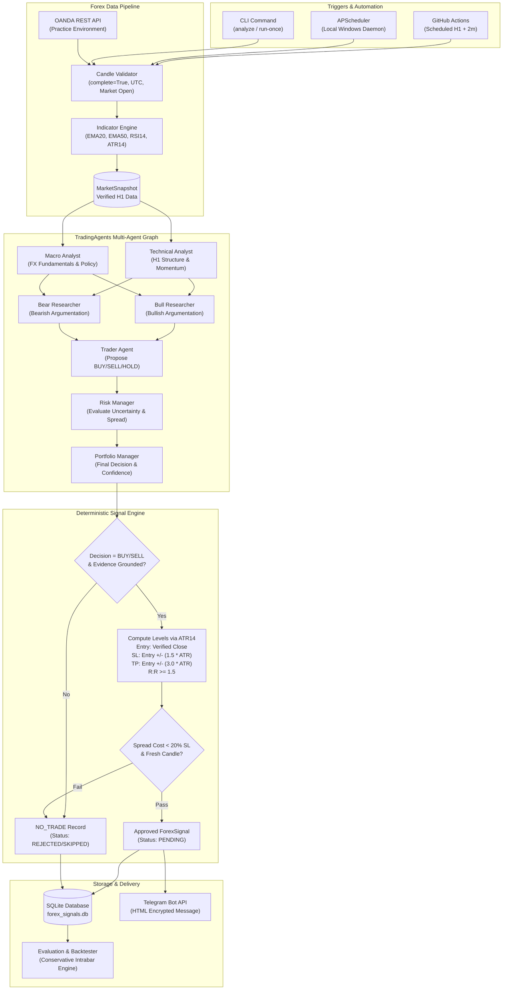
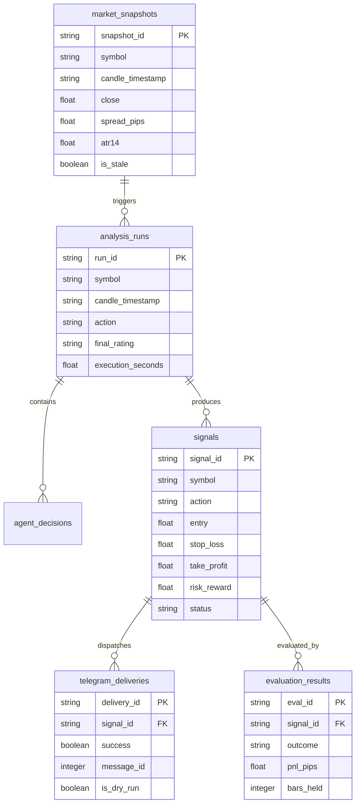

# System Architecture: Forex AI Multi-Agent Telegram Signal Bot

## 1. System Overview

The **Forex AI Multi-Agent Telegram Signal Bot** is a production-oriented quantitative research MVP that monitors and generates high-probability, risk-managed trading signals for major currency pairs on the **1-Hour (H1)** timeframe:
- **EUR/USD**
- **GBP/USD**
- **USD/JPY**

The architecture directly integrates:
1. **TradingAgents Multi-Agent Framework** with LangGraph for agent orchestration, dynamic debate, and consensus.
2. **Google Gemini LLM** (`gemini-2.5-flash` for rapid analysis, `gemini-2.5-pro` for deep risk synthesis).
3. **OANDA REST Practice API** for market data, spreads, and completed H1 candles.
4. **Deterministic Signal Engine** calculating Entry, SL, TP, and R:R from verified market data (preventing LLM hallucination).
5. **Telegram Bot API** for encrypted, formatted signal broadcasts.
6. **SQLite Persistence** and durable idempotency for auditing and performance tracking.

---

## 2. End-to-End Architecture Diagram

---

## 3. Multi-Agent Orchestration & Logical Roles

The system adapts the open-source `TradingAgents` LangGraph workflow specifically for Forex H1 candles:

| Agent Role | Model Tier | Core Responsibility & Constraints |
| :--- | :--- | :--- |
| **Technical Analyst** | Quick (`gemini-2.5-flash`) | Analyzes verified H1 price structure, candle wicks, EMA20/EMA50 trends, RSI14 momentum, and ATR14 volatility. Must never extrapolate fake future candles. |
| **Macro Analyst** | Quick (`gemini-2.5-flash`) | Contextualizes currency pair macro dynamics (interest rate differentials, central bank stances: Fed, ECB, BoE, BoJ). Explicitly forbidden from inventing economic releases. |
| **Bull Researcher** | Quick (`gemini-2.5-flash`) | Synthesizes exclusively the bullish evidence, support zones, and upside catalysts from the analysts' reports. |
| **Bear Researcher** | Quick (`gemini-2.5-flash`) | Synthesizes exclusively the bearish evidence, resistance barriers, and downside risks from the analysts' reports. |
| **Trader Agent** | Quick (`gemini-2.5-flash`) | Weighs the debate between Bull and Bear. Formulates an initial trading proposal (`BUY`, `SELL`, or `HOLD`). |
| **Risk Debater** | Deep (`gemini-2.5-pro`) | Stress-tests the proposal against market conditions, volatility spikes, high spreads, and session liquidity. Recommends risk modifications or veto. |
| **Portfolio Manager** | Deep (`gemini-2.5-pro`) | Acts as the ultimate authority to make the final determination: `Buy`, `Sell`, or `Hold`. Fails safely to `Hold` upon conflicting or low-conviction evidence. |

---

## 4. Deterministic Signal Engine

To prevent LLM hallucination and price invention:
1. **Price Grounding**: Entry price is strictly locked to the verified `close` of the completed H1 candle.
2. **Dynamic Volatility Bands**:
   - `SL_distance = 1.5 * ATR14`
   - `TP_distance = 3.0 * ATR14`
   - Yields a baseline theoretical **Risk/Reward ratio of 2.0:1** (configurable minimum >= 1.5).
3. **Pip Precision**:
   - **EUR/USD & GBP/USD**: 1 pip = `0.0001` (4 decimals).
   - **USD/JPY**: 1 pip = `0.01` (2 decimals).
4. **Transaction Cost Filter**:
   - If `Spread / SL_distance > 0.20` (spread consumes more than 20% of the stop loss buffer), the trade is immediately rejected as `NO_TRADE` due to excessive frictional drag.
5. **Deduplication**:
   - The engine generates a SHA256 idempotency signature based on `(pair, candle_timestamp, action)` to ensure no duplicate signal can be processed or sent to Telegram.

---

## 5. Storage Schema & SQLite Architecture

The database [`app/storage/database.py`](file:///app/storage/database.py) manages 6 relational tables:

---

## 6. Failsafe Mechanisms

- **Completed Candle Gate**: The OANDA client queries with `complete=True` and discards any active, forming candle.
- **Weekend / Closure Shield**: Automatic detection of market closures (Friday 21:00 UTC to Sunday 21:00 UTC) aborts queries before hitting OANDA servers.
- **Fail-Safe to NO_TRADE**: If any LLM API error, network timeout, rate limit, or invalid response occurs, the pipeline catches the exception, logs it with traceback, and outputs an audited `NO_TRADE` decision.
- **Zero Real-Money Risk**: The system contains no broker order execution methods. It is mathematically impossible for the bot to place real orders or risk capital.
